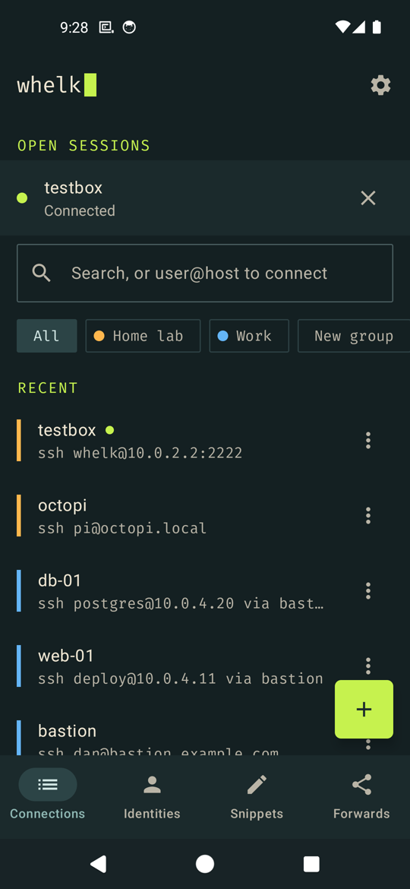
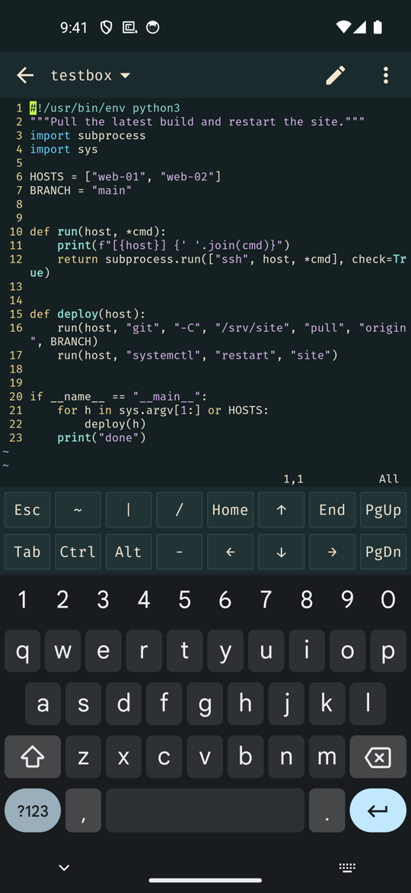

# Whelk

It's weird how hard it is to find a good, current, featureful, and free SSH client for Android. Here's one.

Whelk is an SSH client for Android 8.1 and up. It also does Mosh, Telnet, serial over USB and Bluetooth, plain network connections, and a local shell.

It started as a replacement for the discontinued JuiceSSH and has many of its features: connections, identities and groups, snippets, port forwards, jump hosts, sync and a good terminal. Then I added an SFTP browser, serial consoles, agent forwarding, certificates and security keys - maybe more to come?

I'm calling this 0.5 as it's new and there are rough edges still. I'm working on it.

Dan

---

## Screenshots

<table>
  <tr>
    <td align="center" width="50%"></td>
    <td align="center" width="50%"></td>
  </tr>
</table>

## Installing

The easiest way to install Whelk and keep it up to date is through my F-Droid repo:

[https://hunke.ws/fdroid/repo](https://hunke.ws/fdroid/repo?fingerprint=80438B253C257BCCE05CDCB9E3AC9B6174C2250659962B14FCBE7F32FD42D53E)

Then search for Whelk in F-Droid. When a new version comes out, F-Droid will offer it as an update.

You can also download the APK from the [Releases](https://github.com/roge-rm/Whelk/releases).

## What's in it

### Connections

- SSH, Mosh, Telnet, USB and Bluetooth serial, and the phone's own shell
- Raw TCP, for ser2net, console servers and MUDs
- Identities (password, key or both) shared between connections
- Groups with colours, search, and recent connections at the top
- Type `user@host:port` in the search box to connect
- Jump hosts, and HTTP or SOCKS proxies
- Keepalive, compression, environment variables, character set, Backspace and tmux options
- Host keys checked and saved, with a warning if one changes
- Reconnects after a drop, keeping the screen
- Launcher and home screen shortcuts

### Keys and logins

- Make Ed25519, ECDSA and RSA keys, or import OpenSSH, PEM, PKCS#8 and PuTTY keys
- Keyboard-interactive logins, for two-factor codes
- OpenSSH certificates
- Keys made in the phone's secure hardware, unlocked with your fingerprint or screen lock
- FIDO security keys over USB or NFC
- Agent forwarding, asking before each use

### The terminal

- Full colour, Unicode, mouse support and searchable scrollback
- Fira Mono, JetBrains Mono, Hack and Caskaydia Cove with powerline and icon symbols, or your own font
- Colour schemes built in, or imported from iTerm2, Xresources, Termux, Windows Terminal and Alacritty
- An extra keys row (Esc, Tab, Ctrl, Alt, arrows, F keys) you can rearrange
- Pinch or volume keys for text size
- Swipe to switch sessions, or tmux and screen windows
- Paste without the hidden characters and curly quotes web pages bring along
- Open links on screen
- Several sessions at once, and typing into several at once
- Record sessions to text files
- Notifications for new output, quiet, chosen words, the bell, or when a program asks

### Snippets and port forwards

- Snippets with `{{placeholders}}`, and one to run on connect
- Local, remote and SOCKS forwards, started by hand, with the connection or from a widget
- Open a local forward in the browser

### Files

- An SFTP browser: open, download, upload, rename, delete and make folders
- Edit a file in any editor app, and it uploads each time you save

### Your setup

- Everything encrypted on the phone, with an optional fingerprint or PIN lock
- Encrypted backups, and sync through a folder (Syncthing, Nextcloud, etc), with or without your passwords and keys
- Share a group of connections as a file
- Import `~/.ssh/config`, `known_hosts` or PuTTY sessions
- Dark and light themes

## Keyboard shortcuts

With a keyboard plugged in:

| | |
|---|---|
| Ctrl+Shift+C | copy what's selected |
| Ctrl+Shift+V | paste |
| Ctrl+Shift+F | find |
| Ctrl+Tab, Ctrl+Shift+Tab | next and previous session |
| Ctrl+Shift+plus, minus, 0 | bigger, smaller and normal text |

## Building

You need the Android SDK and NDK. The first build also builds mosh-client for each ABI, which takes a few minutes.

```sh
./gradlew :app:assembleDebug      # debug APK
./gradlew :core:test              # tests
tools/test-server/run.sh          # test OpenSSH server on 127.0.0.1:2222, user and password whelk
WHELK_OPENSSH=127.0.0.1:2222 ./gradlew :core:test   # plus the tests that need it
```

From the emulator, the test server is at 10.0.2.2:2222.

| | |
|---|---|
| Minimum Android | 8.1 (API 27) |
| Built against | API 37 |
| UI | Kotlin, Jetpack Compose |
| SSH | sshj and BouncyCastle |

## Credits

- The terminal is from [Termux](https://github.com/termux/termux-app), under the Apache License 2.0, changed to run over SSH. See [terminal/NOTICE](terminal/NOTICE).
- [Mosh](https://mosh.org) is built from source, under the GPL version 3.
- USB serial uses [usb-serial-for-android](https://github.com/mik3y/usb-serial-for-android), under the MIT licence.
- Security keys use Yubico's [yubikit-android](https://github.com/Yubico/yubikit-android), under the Apache License 2.0.
- The fonts are [Nerd Fonts](https://www.nerdfonts.com) builds of Fira Mono, JetBrains Mono, Hack and Cascadia Code, with their licences in `app/src/main/assets/fonts`.

## Licence

Whelk is free software under the GNU General Public License, version 3 or later. See [LICENSE](LICENSE).

Copyright © 2026 Dan Hunke.
